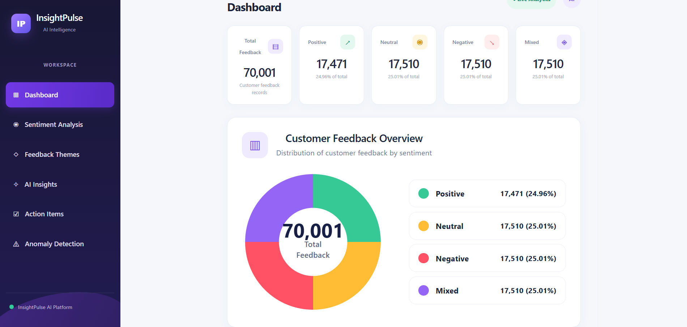
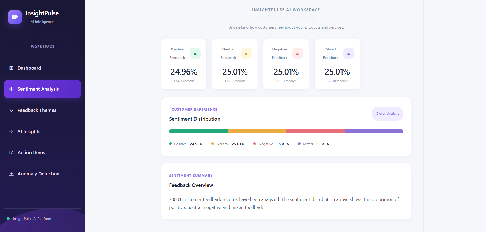
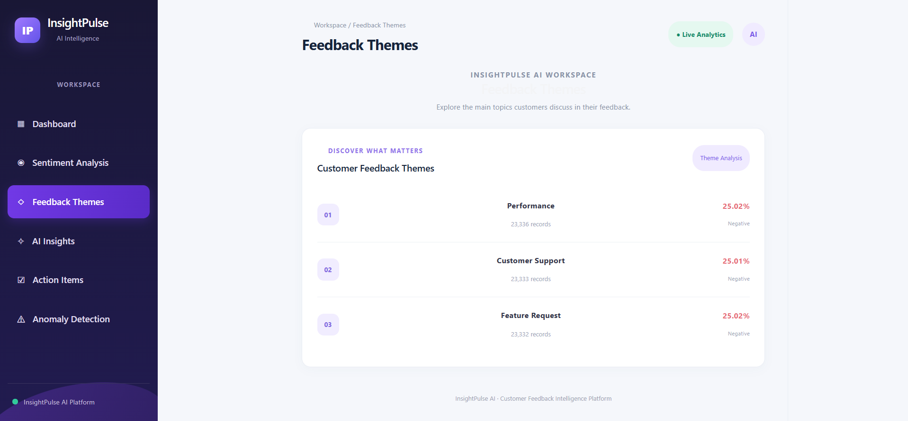
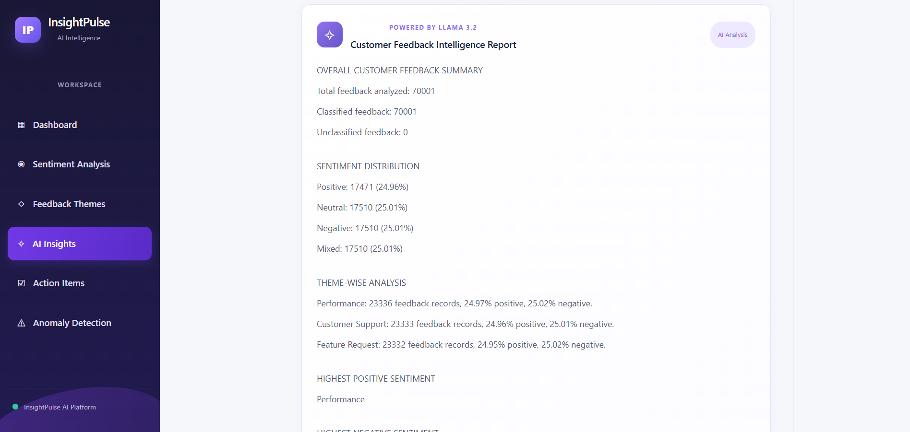
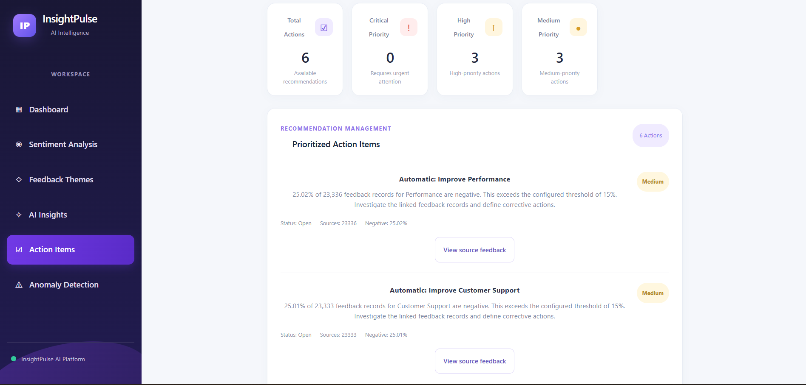
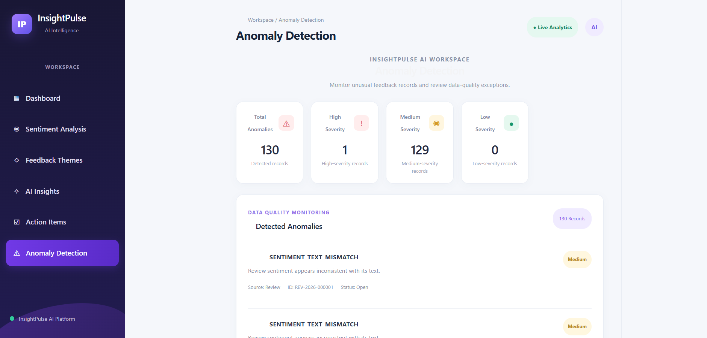

# InsightPulse AI — Customer Feedback Intelligence Platform

An AI-powered customer feedback intelligence platform that consolidates customer reviews, survey responses, and support messages to analyze sentiment, identify recurring feedback themes, detect data-quality anomalies, and generate actionable business recommendations.

## 1. Project Overview

Organizations receive customer feedback through multiple channels. Manually analyzing large volumes of feedback makes it difficult to identify recurring issues, understand customer sentiment, and prioritize improvements.

**InsightPulse AI** provides a centralized intelligence platform that transforms unstructured customer feedback into structured insights.

### Business Workflow and Stakeholders

InsightPulse AI supports the feedback-intelligence workflow used by customer-facing and business operations teams. Customers and prospects provide feedback through product reviews, surveys, and support interactions. Marketing and sales operations teams can use the consolidated feedback to understand customer concerns and recurring themes. Support agents can investigate individual feedback records, while analysts can review sentiment, theme distributions, trends, anomalies, and recommended actions. System administrators are responsible for maintaining the application and its underlying data.

The implemented workflow begins by creating master records for customers, products, channels, and surveys. Review, survey-response, and support-message records are then generated with references to their parent records. Feedback is classified using the configured sentiment categories and theme taxonomy. The application aggregates the resulting records for dashboard analytics, identifies data-quality exceptions, and generates action items when the configured negative-feedback threshold is exceeded. Each generated action item can be traced back to its supporting feedback through the ActionItemFeedback mapping.

These stakeholder descriptions explain the business users and systems addressed by the solution. They do not imply that separate role-based authentication or permission controls are implemented.

### Key Capabilities

- Multi-source customer feedback aggregation.

- AI-powered sentiment classification.

- Theme-based feedback analysis.

- Customer feedback analytics and visualization.

- Data-quality anomaly detection.

- Automated action-item generation.

- Source-level feedback traceability.

- LLM-powered customer feedback insights.

- Interactive analytics dashboard.

- PII detection and masking in supported feedback workflows.

## 2. Technology Stack
| Component | Technologies |
|---|---|
| Frontend | React 19, Vite |
| Backend | Python, FastAPI |
| Database | SQLite, SQLAlchemy |
| Machine Learning | scikit-learn, TF-IDF, Logistic Regression |
| Data Processing | Pandas, NumPy |
| AI Insights | Ollama, Llama 3.2 |
| API Documentation | FastAPI, Swagger UI |

## 3. System Architecture

```text

             CUSTOMER FEEDBACK SOURCES
                         |

          +--------------+--------------+
          |              |              |

       Reviews       Surveys       Support Messages
          |              |              |

          +--------------+--------------+
                         |

                         v

                FASTAPI BACKEND
                         |

          +--------------+--------------+
          |              |              |

      Sentiment       Theme         Data Quality

      Analysis       Detection       Validation
          |              |              |

          +--------------+--------------+
                         |

                         v

                  SQLITE DATABASE
                         |

          +--------------+--------------+
          |              |              |

      Analytics     Action Items    Anomalies
          |              |              |

          +--------------+--------------+
                         |

                         v

                 AI INSIGHTS SERVICE
                         |

                    OLLAMA / LLM
                         |

                         v

                 REACT DASHBOARD
                         |

          +--------------+--------------+
          |              |              |

       Dashboard    AI Insights    Action Items
          |              |              |

       Sentiment     Themes       Anomalies
                         |

                         v

                 CUSTOMER INSIGHTS

```

## 4. Feedback Classification

### Sentiment Categories

The platform supports four sentiment categories:

- Positive

- Neutral

- Negative

- Mixed

### Feedback Themes

The classification system supports three predefined themes:

- Performance

- Customer Support

- Feature Request

Feedback is processed to identify sentiment and categorize recurring customer concerns.

## 5. Synthetic Dataset

The project uses reproducible synthetic customer feedback data for development, model training, and evaluation.

### Full Dataset Summary
| Dataset | Records |
|---|---:|
| Customers | 5,000 |
| Products | 5 |
| Channels | 5 |
| Surveys | 100 |
| Reviews | 30,000 |
| Survey Responses | 20,001 |
| Support Messages | 20,000 |
| **Total Feedback Records** | **70,001** |

The dataset includes deliberately injected edge cases for validating data-quality checks, including a duplicate survey submission.

### Dataset Generation

Generate the full synthetic dataset:

```bash

python backend/scripts/generate_synthetic_data.py --scale full

```

The generator uses a fixed random seed:

```text

20261022

```

This supports reproducibility of the generated dataset.

### Dataset Directories

```text

data/

├── generated/

├── generated_full/

├── ground_truth/

├── ground_truth_full/

├── manifests/

├── manifests_full/

└── backup/

```

### Dataset Validation

The full dataset validation manifest records:

- Synthetic data only.

- Fixed generation seed.

- Dataset row counts.

- Sentiment distribution.

- Six ground-truth evaluation cases.

- File checksums and file sizes.

- Validation status: PASSED.

- Validation errors: 0.

The generated dataset contains 70,001 feedback records, with 17,501 Positive, 17,500 Neutral, 17,500 Negative, and 17,500 Mixed labels.

### Sentiment Balance and Ground-Truth Coverage

The full dataset contains four sentiment categories with an approximately equal distribution: 17,501 Positive, 17,500 Neutral, 17,500 Negative, and 17,500 Mixed records. The ground-truth collection contains six deliberately constructed evaluation cases covering a contradictory sentiment label, a duplicate survey response, synthetic PII exposure, an out-of-taxonomy theme, a rating-text mismatch, and a forbidden evaluation-label feature. These cases are kept separate from model-training inputs and are used to exercise the validation and anomaly-handling workflows.

## 6. Machine Learning and Sentiment Analysis

### Model Architecture

The sentiment classification pipeline uses:

1. Text preprocessing.

2. TF-IDF vectorization.

3. Unigram and bigram feature extraction.

4. Logistic Regression classification.

5. Prediction confidence calculation.

The model uses a stratified 80:20 training and testing split.

### Dataset Preparation

Prepare the cleaned sentiment training dataset:

```bash

python ml/prepare_dataset.py

```

The preparation process:

- Selects review text and sentiment labels.

- Removes missing and empty records.

- Removes conflicting sentiment labels for identical text.

- Excludes ground-truth review records.

- Removes duplicate sentences.

- Validates the four required sentiment classes.

### Model Training

Train and evaluate the sentiment model:

```bash

python ml/sentiment_model.py

```

The trained pipeline is saved locally:

```text

ml/sentiment_pipeline.joblib

```

### Model Evaluation

Latest recorded evaluation:
| Metric | Result |
|---|---:|
| Test Accuracy | 68.97% |
| Training Examples | 115 |
| Testing Examples | 29 |
| Total Prepared Examples | 144 |
| Sentiment Classes | 4 |

The evaluation uses a small, balanced synthetic dataset. These results represent preliminary model performance and should not be interpreted as production-level accuracy or generalization to real-world customer feedback.

## 7. Theme Detection

The platform organizes customer feedback into the predefined themes:

- Performance

- Customer Support

- Feature Request

Theme detection supports the identification of recurring customer concerns and provides structured information for analytics and action-item generation.

## 8. Anomaly Detection

InsightPulse AI includes data-quality anomaly detection to identify potentially problematic feedback records.

### Supported Anomaly Categories

- Duplicate submissions.

- Personally identifiable information (PII).

- Invalid or out-of-taxonomy feedback themes.

- Rating and feedback-text inconsistencies.

- Sentiment-label inconsistencies.

Detected anomalies are stored and made available through the backend and dashboard for review.

## 9. AI-Generated Insights

The AI Insights module uses Ollama with Llama 3.2 to generate natural-language insights from customer feedback analytics.

The module helps transform structured feedback information into understandable summaries and recommendations.

## 10. Action Item Generation and Source Traceability

The platform generates actionable recommendations based on negative feedback patterns.

### Action Generation Workflow

1. Group feedback by theme.

2. Analyze negative feedback percentages.

3. Compare negative feedback against the configured threshold.

4. Generate recommendations when the threshold is exceeded.

5. Associate action items with their supporting feedback records.

6. Retrieve source feedback for investigation.

The configured automatic action-generation threshold is 15%.

Source-level traceability allows users to inspect the feedback records associated with generated action items.

## 11. Frontend Application

The React dashboard provides six main application pages:
| Page | Purpose |
|---|---|
| Dashboard | Overall customer feedback analytics |
| Sentiment Analysis | Sentiment classification and distribution |
| Feedback Themes | Theme-based feedback analysis |
| AI Insights | AI-generated customer feedback insights |
| Action Items | Recommendations and source feedback traceability |
| Anomaly Detection | Data-quality issues and anomaly summaries |

## 12. Database Design

The application uses SQLite with SQLAlchemy ORM.

Database location:

```text

backend/insightpulse.db

```

### Database Tables

The implemented database contains 12 tables:
| Table | Purpose |
|---|---|
| customers | Customer information |
| products | Product information |
| channels | Feedback channels |
| surveys | Survey information |
| reviews | Customer product reviews |
| survey_responses | Customer survey feedback |
| support_messages | Customer support conversations |
| themes | Feedback theme definitions |
| sentiment_labels | Sentiment category definitions |
| action_items | Generated recommendations |
| action_item_feedback | Action-item to source-feedback mappings |
| anomaly_records | Detected data-quality anomalies |

The database uses primary keys and the implemented foreign-key relationships to maintain relational integrity.

## 13. API Documentation

The backend exposes REST APIs through FastAPI.

### API Capabilities

- Customer management.

- Product management.

- Review management.

- Survey management.

- Survey response management.

- Support message management.

- Sentiment prediction.

- Theme detection.

- Feedback analytics.

- Anomaly detection.

- Action-item management.

- Action-item source-feedback retrieval.

- AI-generated insights.

### API Documentation

FastAPI Swagger UI provides interactive API documentation, request schemas, and response information.

```text

http://127.0.0.1:8000/docs

```

## 14. Data Privacy and Ground-Truth Isolation

The project includes data-quality and evaluation safeguards.

- Synthetic data is used for development and testing.

- PII detection and masking are included in supported feedback workflows.

- Ground-truth evaluation records are maintained separately from model-training inputs.

- The sentiment preparation script excludes all ground-truth records identified as Review records.

- The training script rejects evaluation-related columns such as `test_label`, `ground_truth`, `expected_sentiment`, `expected_decision`, and `issue_type`.

- Ground-truth cases are preserved for evaluation and validation.

- A final training-dataset check confirms that no ground-truth review IDs remain.

The ground-truth dataset contains six evaluation cases covering sentiment inconsistency, duplicate submissions, PII leakage, invalid themes, rating-text mismatch, and model-input leakage.

## 15. Project Structure

```text

insightpulse-ai/

│

├── backend/

│   ├── app/

│   │   ├── api/

│   │   ├── core/

│   │   ├── db/

│   │   ├── models/

│   │   ├── schemas/

│   │   ├── services/

│   │   └── main.py

│   │

│   ├── scripts/

│   │   └── generate_synthetic_data.py

│   │

│   └── requirements.txt

│

├── frontend/

│   ├── public/

│   ├── src/

│   ├── package.json

│   └── vite.config.js

│

├── ml/

│   ├── import_feedback_to_database.py

│   ├── prepare_dataset.py

│   ├── run_theme_detection.py

│   └── sentiment_model.py

│

├── data/

│   ├── generated/

│   ├── generated_full/

│   ├── ground_truth/

│   ├── ground_truth_full/

│   ├── manifests/

│   ├── manifests_full/

│   └── backup/

│

├── docs/

│   └── data_dictionary.md

│

└── README.md

```

## 16. Installation and Setup

### Prerequisites

- Python 3.12+

- Node.js and npm

- Git

- Ollama (for local LLM-powered insights)

### Backend Setup

From the project root:

Create a virtual environment:

```bash

python -m venv backend/.venv

```

Activate it in Git Bash:

```bash

source backend/.venv/Scripts/activate

```

Install dependencies:

```bash

pip install -r backend/requirements.txt

```

Generate the full dataset if required:

```bash

python backend/scripts/generate_synthetic_data.py --scale full

```

Start the backend:

```bash

python -m uvicorn app.main:app --reload --app-dir backend

```

Backend URL:

```text

http://127.0.0.1:8000

```

Swagger documentation:

```text

http://127.0.0.1:8000/docs

```

### Frontend Setup

Open another terminal:

```bash

cd frontend

npm install

npm run dev

```

Frontend URL:

```text

http://localhost:5173

```

### Production Build

From the frontend directory:

```bash

npm run build

```

## 17. Testing and Validation

The following checks have been completed during development:

- Frontend production build completed successfully.

- FastAPI backend started successfully.

- All six frontend pages were verified.

- Action-item source traceability was verified.

- Anomaly detection page and summary were verified.

- Full dataset manifest validation passed with zero reported validation errors.

- Six ground-truth evaluation cases were verified.

- Duplicate survey submission was verified.

- Ground-truth review exclusion from sentiment training was verified.

- Sentiment model training completed successfully.

- Saved sentiment model loading and prediction were tested.

The sentiment model's prediction quality remains an area for further improvement due to the limited number of unique synthetic training examples.

## 18. Project Objective

InsightPulse AI demonstrates an integrated approach to customer feedback intelligence using machine learning, natural language processing, LLM-based insights, backend API development, relational database management, anomaly detection, and interactive data visualization.

The platform converts feedback from multiple sources into structured analytics, identifies customer concerns, and supports data-driven business decisions through traceable recommendations.

---

**Project:** InsightPulse AI — Customer Feedback Intelligence Platform

**Repository:** https://github.com/nikhithabhandary08/insightpulse-ai

## Application Screenshots

The following screenshots showcase the main features of the InsightPulse AI platform.

### 1. Dashboard



### 2. Sentiment Analysis



### 3. Feedback Themes



### 4. AI Insights



### 5. Action Items



### 6. Anomaly Detection


